## The Challenge

The digital solutions team at Convatec had spent a significant amount of defining attempting to define an MVP for a patient companion app that would enable ostomy patients to track when they changed their devices, record skin conditions, and learn more about living with their condition.

Following a round of usability testing significant concerns were identified around the organization of content within the application, the complexity of recording information, and the length of the onboarding flow. Despite having pretty robust interface designs, the original team had not taken the time to define the foundational UX.

### Obstacles

Individually, a extraordinary amount of effort had gone into conducting usability research, developing content, and establishing a visual design language. The app was missing the strategic definitions and design-thinking process to connect this into a viable user experience. Behind schedule and needing to move into development as quickly as possible I was given 6-9 months to completely re-evaluate and re-architect the design into a solution that would be solve the identified issues and bring values to the target user.

#### The key issues I needed to solve

##### 1. Lack of design system

One of the immediate issues identified within the original design file was a lack of design system or shared component library. This resulted in a significant amount of patterns being re-built each time they were needed, and increased the level of effort required to make even minor changes. Not having properly structured design files and component libraries increases the downstream efforts of development and risks the consistency of elements and interactions across the application.

##### 2. Content library misalignment

One of the most significant aspects of the app was to be a robust learning center, with video and written content, intended to help ostomy patients learn more about living with and managing their condition. Depending on the user’s point in their medical journey their recommended content needed to shift, and a certain level of guidance was meant to be provided. Upon discussions with the content team it was rapidly identified that the original design of this feature was not aligned with the structure of available content.

##### 3. No foundational UX

The original team had made a fatal mistake and had jumped right into high-fidelity design when working on the initial version. This left the app without a defined user experience and compounded issues across the app’s information architecture, user states, and functionality.

  <figure>
    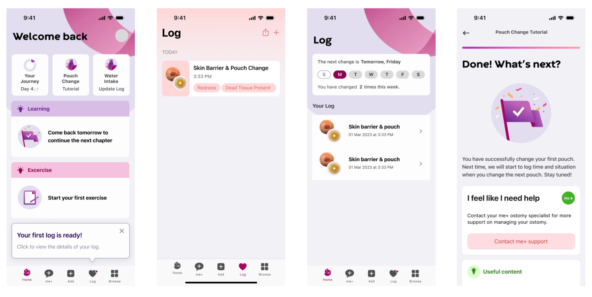
    <figcaption>Samples from the original app design.</figcaption>
  </figure>
  <figure>
    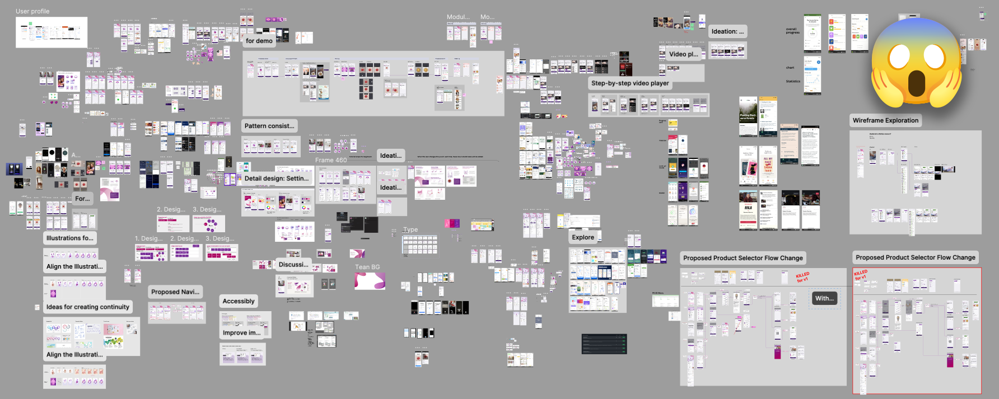
    <figcaption>The original design file lacked any clear system of organization, and was difficult to know what work was in-progress/conceptual vs. “finalized.”</figcaption>
  </figure>

---

## The Solution

I immediately pulled the team back from hi-fidelity design and began auditing the proposed user flows and functionality. Through this process I worked closely with the research, content, and marketing teams to identify the points where user needs, content structure, and technical requirements were not being met.

### Establishing a design system

Defining a cohesive visual identity throughout the app and creating a shared component library was essential to a building a sustainable design process for the team. In addition to improving consistency across the application working from a design system improves the speed and efficiency of both design and development processes, and sets a foundation for future expansion and scalability of the product.

#### The methods I employed for this design phase

##### 1. Defining foundational design tokens

Using the brand standards defined at the program level, and the foundational aspects of the existing visual identity I created a token library to define the base attributes for the rest of the library.

While this design library was initially created to support this application, it was ultimately evolved to be able to be used across additional products that with their own unique sub-brands.

  <figure>
    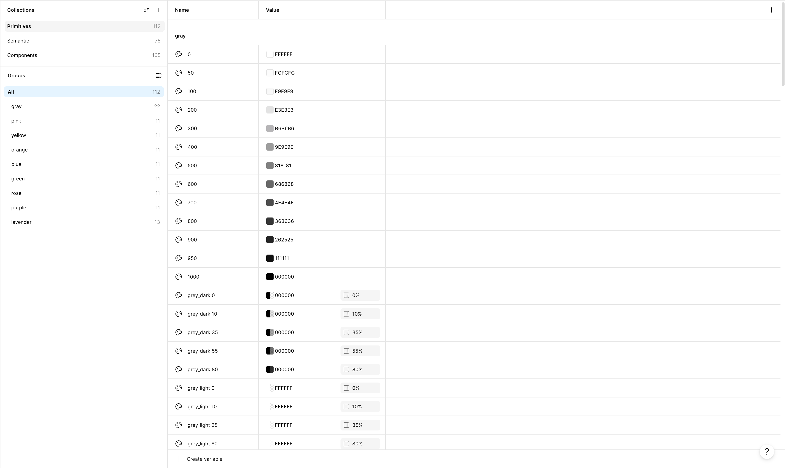
    <figcaption>The overarching Convatec Brand Guidelines defined the primitive design tokens. These are the values that are directly referenced within the semantic, sub-brand definitions.</figcaption>
  </figure>
  <figure>
    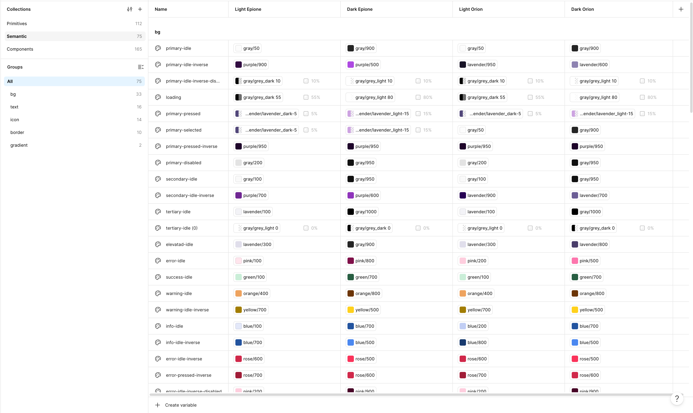
    <figcaption>The semantic token structure defines how the primitive brand values are applied to the product-specific sub-brand. These are the values that are directly referenced within component definitions.</figcaption>
  </figure>

##### 2. Building components

The original design served as a valuable starting point for establishing the visual starting point for a large number of needed components. As we re-worked each of the core features of the app, I made sure to evaluate the required components and user states—ensuring that any neceessary components and functionality was included in the formal documentation.

  <figure>
    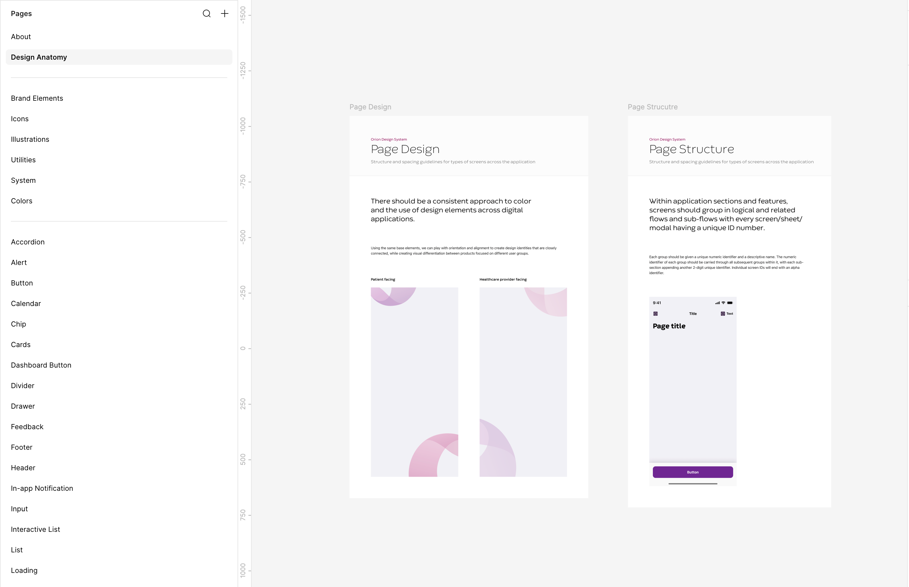
    <figcaption>A snapshot of the structure of the design system’s component library.</figcaption>
  </figure>
  <figure>
    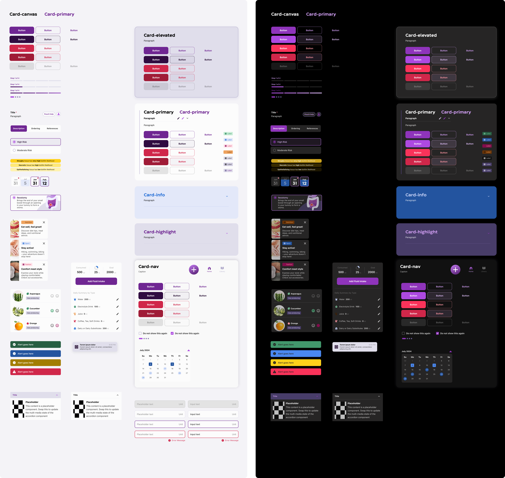
    <figcaption>A preview of some of the main components documented within the component library.</figcaption>
  </figure>

### Fixing the content library misalignment

One of the main aspects of the app was the segmentation of content relevant to the stage of medical treatment the patient was in. While the original design captured this at a high-level, I discovered it was not completely aligned with the actual medical benchmarks within the industry, and failed to account for necessary logic changes based on a user’s stoma type and profile status.

#### The methods I employed for this design phase

##### 1. Establishing the relationship between content and type of user

Three factors impacted the relevancy and accessibility of articles to an individual user. These factors were the patient’s stoma type, the phase of medical treatment they were in, and their registration status to the broader patient program. These attributes impacted the accessibility of content across the whole application, and needed to be defined for each individual article that had been developed.

  <figure>
    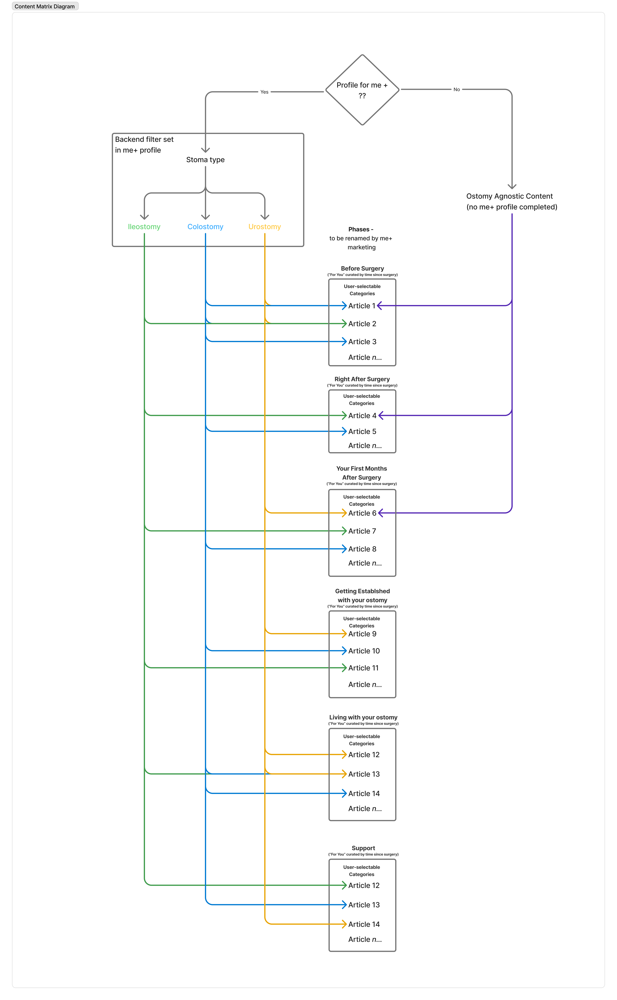
    <figcaption>Technical diagram defining the logic behind the filtering and display of information within the content library based on user type and state.</figcaption>
  </figure>
  <figure>
    
    <figcaption>A breakdown of accessible content, featured and non-featured, based on a user’s ostomy type and profile registration status.</figcaption>
  </figure>

##### 2. Identifying the necessary points of discovery

A subset of total articles were meant to be featured for each medical phase. Through user testing a need to enable additional search and discovery of the reimagine content was identified. In order to ensure the necessary functionality was captured I used flow diagrams to document the intended progression of discoverability and align stakeholders on the requirements.

  <figure>
    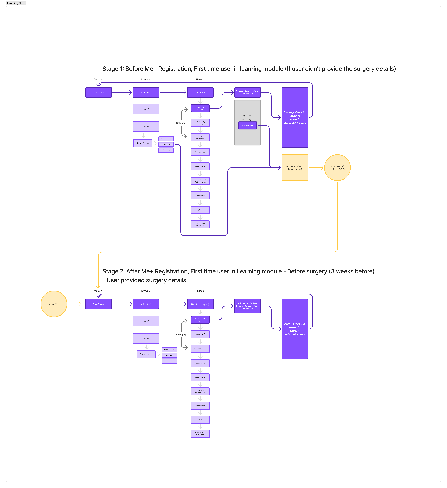
    <figcaption>Flow diagrams documenting the discoverability of content based on categorization.</figcaption>
  </figure>
  <figure>
    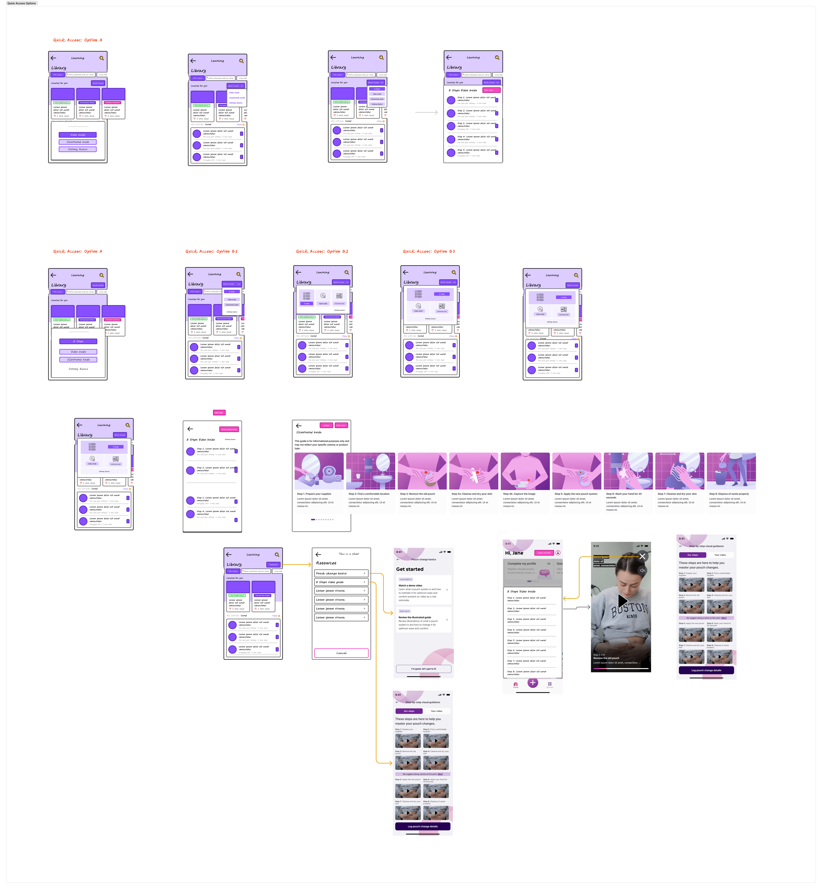
    <figcaption>User research revealed that new ostomates struggle to remember the proper medical protocols when they immediately need to use them. Pictured here is my exploration into how we could develop a series of support videos and provide quick access to support users when they needed simple support at a vulnerable point.</figcaption>
  </figure>

### Building the foundational UX

Because the original design team had not laid the necessary groundwork to define the necessary user experience—instead jumping right into high-fidelity concepts—the original MVP had major gaps in it’s functionality and did not align with the needs or objectives of its target audience. Stakeholders were struggling to align on the requirements of the application and the functionality of the app wasn’t clear.

Stepping back to establish that ground work and transforming the original design into a comprehensive product that could be approved and built was my overall objective.

#### The methods I employed for this design phase

##### 1. Defining user flows through wire-framing

Using the results of the usability testing and the business requirements I reworked each of the core features. Using wireframes to outline and evaluate the proposed design hypothesis allowed me to work through potential issues, account for user states and functional requirements, and align stakeholders more rapidly and collaboratively.

By separating the process of defining the app’s user experience from the look and feel of the UI, the conversations around the solution are able to remain more focused on functionality and flow.

  <figure>
    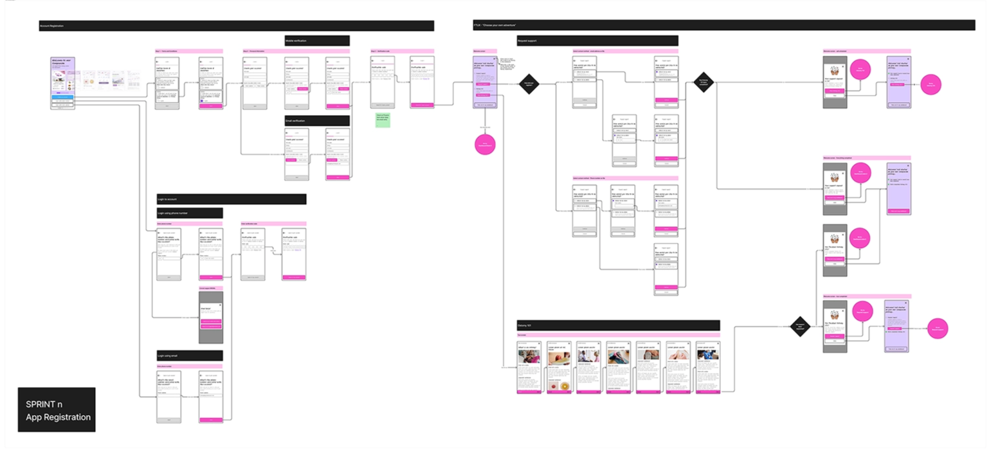
    <figcaption>A sample of the registration requirements and user process defined through wireframes. The previous team had spent months reworking an authentication process that failed to align stakeholders and was missing key functionality. <strong>Stepping back into wireframes let us work through the requirements of the process and get stakeholder approval on the direction within one sprint.</strong></figcaption>
  </figure>

##### 2. Skinning the UI

As I progressed through the re-evaluation of each core feature in the application—leveraging wireframes to define the user flows and functionality—the impacted screens of each user flow were moved into high-fidelity design upon approval.

Using the approved user flows, and the established design library, the actual construction of the high-fidelity UI’s was able to produced quickly and efficiently.

  <figure>
    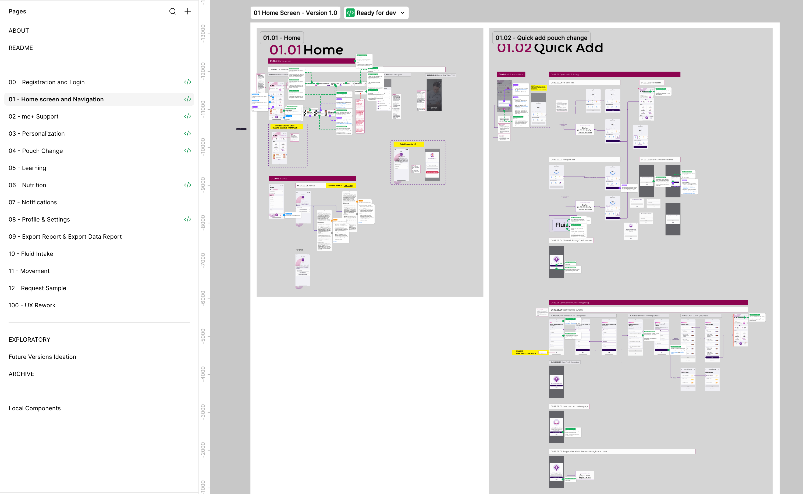
    <figcaption>Organized by primary feature, the final design file provides a comprehensive source of truth for the entire UX/UI of the application. Within each feature I have organized and documented the relative sub-features and user flows; with details regarding functionality and intent annotated throughout the file.</figcaption>
  </figure>
  <figure>
    
    <figcaption>Final versions of key screens across the experience.</figcaption>
  </figure>

---

## The result

I joined this product after the original team had already spent two years struggling to finalize the design of this product. 3 months after beginning the redesign efforts we were able to begin handing off screens to the development team. Roughly 6 months after beginning, we completed the redesign and entered design lock. Roughly one year after I joined the team, the app was publicly released.

Unfortunately, new registrations wound up being paused within a year of its launch. From a business perspective, the app was intended to drive registrations into Convatec’s existing Me+ Companion support program—the Me+ team required an introductory phone screen for new registrants. Despite the app’s marketing being limited to referrals through a selected set of partner hospitals the redesigned application wound up providing so much benefit to the initial users that awareness spread through support groups and signups sky-rocketed at a pace that the Me+ Companion team was not willing to provide support for.
